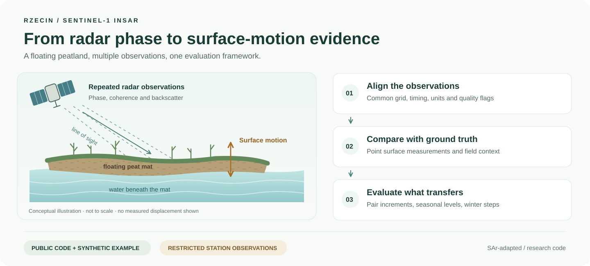
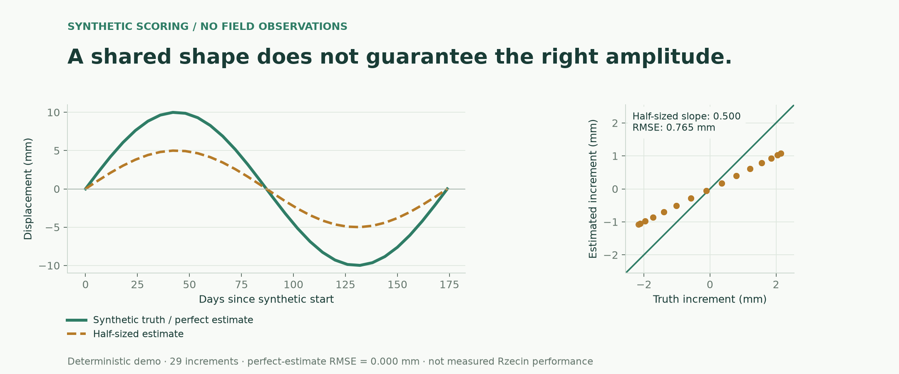

# SAr-adapted



Sentinel-1 InSAR processing and ground-truth evaluation for a floating peatland
at Rzecin, western Poland. The code asks which radar observations can follow the
mat’s vertical motion and how reliably they preserve its level across seasons.

This is research code accompanying an article in preparation. It includes the
analysis library, data-cube pipelines, evaluation protocol, study experiments
and synthetic tests. Field observations and the working manuscript are held
separately; they are not included in this checkout.

## Start here

- [Synthetic scoring example](examples/synthetic_scoring.py): run without field data.
- [Architecture](docs/ARCHITECTURE.md): the library and processing layers.
- [Reproduction and data requirements](docs/REPRODUCIBILITY.md): what runs publicly and what needs study inputs.
- [Study entry points](docs/ENTRY_POINTS.md) and [figure/table map](docs/MANUSCRIPT_MAP.md).
- [Evaluation protocol](config/protocol.yaml) and [citation metadata](CITATION.cff).

## Quick start

Use a source checkout and Python 3.10 or newer:

```bash
git clone https://github.com/AimenSayoud/SAr-adapted.git
cd SAr-adapted
python -m venv .venv
source .venv/bin/activate
python -m pip install -e ".[dev]"
make demo
make test
make lint
make check
```

The demo prints a perfect synthetic pair estimate and a deliberately half-sized
estimate. Tests use synthetic inputs with known answers; an optional integration
test skips when the local data cube is unavailable. Tests do not establish that
every processing route works on real peatland data.



The figure uses the same deterministic series as `make demo`. See the
[public figure gallery](docs/PRESENTATION.md) for sources, regeneration commands
and a preview of the bundled GIS layers.

Optional installation extras are `acquisition` (data-provider clients) and
`figures` (map/figure tools); `.[all]` includes both and development tools. Heavy
SAR dependencies have a separate [Colab setup](colab/README.md).

## Scope and limitations

The study covers radar observations from 2017–2026, with continuous surface-level
validation at one laser point (P6) during 2021–2025. There are no independent
unseen laser years. A comparison at P6 does not validate displacement amplitude
throughout the mat. Weather-driven winter re-levelling is an experimental remedy;
transfer to unseen winters has not been demonstrated. Read the implementation
and its input requirements alongside any reported study result.

## Code and data boundary

`src/` contains reusable methods, `pipelines/` builds data products, and
`experiments/` contains the study analyses. The technical
[execution register](config/register.yaml) retains stable entry IDs and historical
code references. `data/gis/` is a dated first-study context package, including
approximate station reference points; see its [provenance notes](data/gis/README.md).

Station laser, well, meteorology and UAV records belong to the station operators.
They and restricted derived products stay outside the public checkout. Study
commands with private outputs require an external workspace; see
[configuration](docs/REPRODUCIBILITY.md#private-study-workspace).

## Versions and citation

The existing `v1.0.0` tag is the historical September 2026 snapshot, not the
November cleanup. Frozen-method and archive tags are preserved for provenance;
older public refs retain historical drafts and outputs. Cite the exact commit
you use until a new consistently versioned release is published.

Software is available under the [MIT licence](LICENSE). Bundled GIS layers have
their own source/provenance context; the software licence does not replace
third-party data terms. See [CITATION.cff](CITATION.cff) for author metadata.
