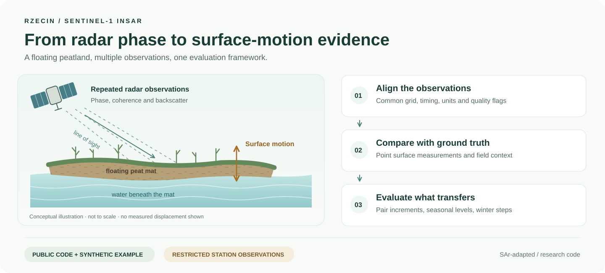
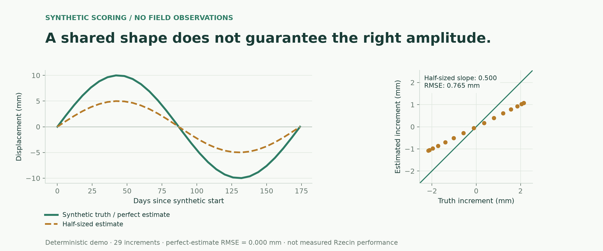
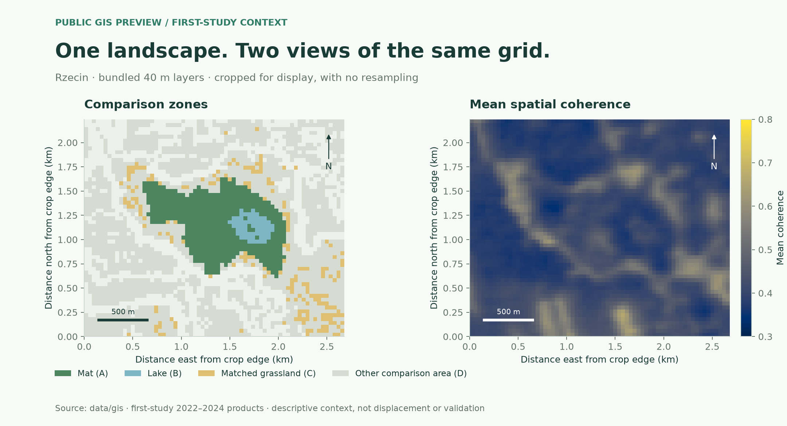

# Public figure gallery

These visuals introduce the code and the public GIS package. They use conceptual
artwork, synthetic inputs or files already bundled publicly; no restricted
station record or private manuscript figure is included.

## Study overview



An editable vector illustration of the observation and evaluation workflow.
Satellite position, mat structure and motion arrows are schematic, not measured
geometry. It contains no displacement result, measured amplitude or station
location. Edit `docs/assets/study-overview.svg` directly; it uses no external
images, scripts or fonts.

## What the scoring example measures



Source: `synthetic_series()` in `examples/synthetic_scoring.py`. Metrics are
computed by `insar_wetlands.scoring.increment_stats`, the same function used by
the terminal demo. Both series have the same timing, but the half-sized estimate
does not recover the amplitude. The displayed values are synthetic and are not
performance claims for Rzecin.

## The public GIS layers



Sources: `data/gis/zones_classified_raster.tif` and
`data/gis/mean_coherence_spatial.tif`. The generator crops around the mat/lake
with surrounding comparison context and displays the original grid cells with
nearest-neighbour rendering; it does not interpolate, reproject or change source
values. Both panels share a crop and orientation. Axes give relative distances
from the crop edge in kilometres; each scale bar is 500 m.
The coherence colour scale spans 0.3–0.8 to show local variation; the source
values are unchanged. Pale blank zone cells are outside the classified zones.

This is **first-study 2022–2024 context**. Mean coherence is a descriptive radar
quantity, not displacement, measurement accuracy or field validation. No station
points are drawn. Source and third-party data limitations remain those described
in [GIS provenance](../data/gis/PROVENANCE.md).

## Regenerate the plots

From a source installation with the core package dependencies:

```bash
make presentation
```

The script `scripts/build_presentation_figures.py` uses Matplotlib in its headless
Agg mode. It reads only the two public GIS rasters and the shared synthetic
example, needs no network or private workspace, and writes the two PNG files in
`docs/assets/`. Plot values/crops are deterministic; exact PNG bytes may differ
with Matplotlib/font-rendering versions. The conceptual SVG is maintained as
editable source.
